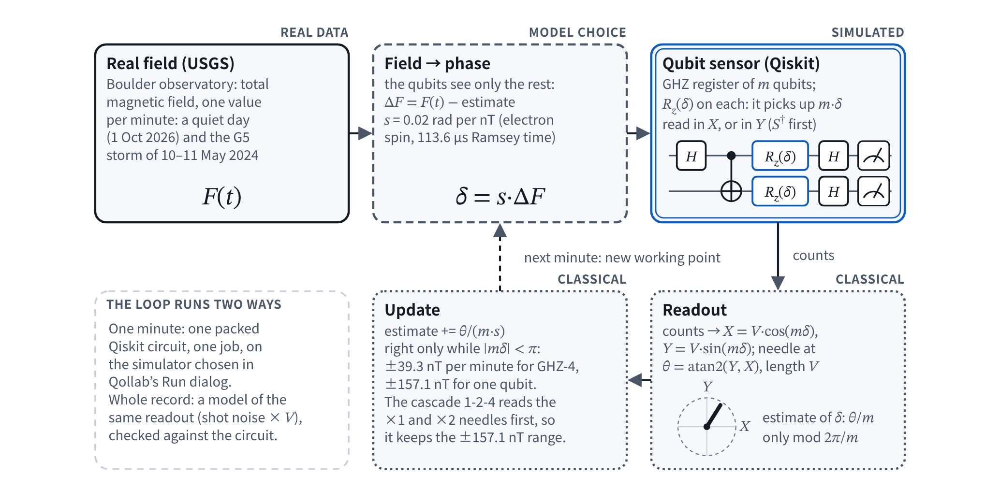
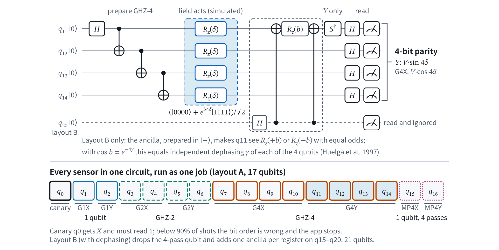
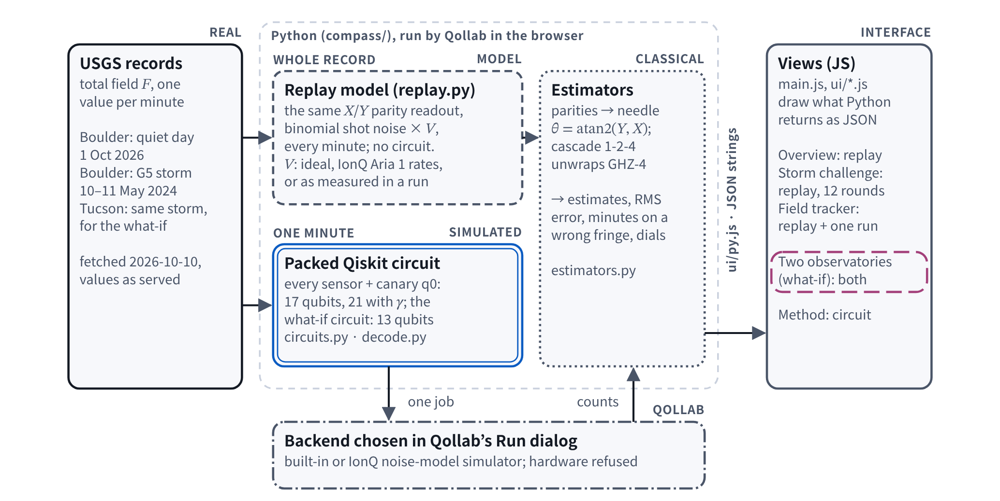

# Entangled Compass: is a GHZ sensor really $`\sqrt{N}`$ better?

> **Theme: Quantum Playground** · Qollab × IonQ Global Quantum Hackathon 2026 · team Quantum Daemons
> Repository: https://github.com/thedaemon-wizard/Qollab_IonQ_Entangled_Compass
> Demo video (2:59, YouTube, synthetic narration, English captions): https://youtu.be/easdOjNDF_k

Qollab's own example project *Scaled Entanglement* says that an $`N`$-qubit GHZ sensor is $`\sqrt{N}`$ times
more precise than $`N`$ independent sensors. That is true in the ideal case: the same qubits, the
same interrogation time, no noise, and a field already known to within a narrow range. This
playground puts simulated qubit sensors on a **real record**, the total magnetic field measured
at the USGS Boulder observatory, on a quiet day and through the G5 storm of 10–11 May 2024, and
lets you find out where the $`\sqrt{N}`$ survives and where it breaks.

Everything quantum here is a Qiskit circuit or the exact model of one; the field data are real;
nothing ran on a magnetometer or on quantum hardware.

## What it does

- **Storm challenge** (the game). Twelve two-hour rounds through the storm. Before each round
  you see only the past and pick a sensor: 8 independent qubits, a GHZ-4 pair of registers
  (twice as precise, but it loses its place if the field jumps more than ±39.3 nT in one
  minute), or a 1-2-4 cascade that costs 14 qubits. The round is replayed with your pick and
  compared with what the other two would have done from the same start and the same random
  seed. Keeping a sensor keeps its estimate, so a GHZ-4 that jumped a fringe stays off until
  another jump happens to bring it back; switching starts the new sensor from a fresh absolute
  fix (we assume a slow absolute reference, such as the observatory's own instrument, is
  available when you switch).
- **Field tracker.** Replays a whole record with every sensor arm (32 replays) and shows the
  field, each arm's estimate and its error, with a table of RMS error, minutes on a wrong
  fringe and fringe jumps. Settings: record (quiet day or storm), shots, added dephasing $`\gamma`$, and
  the gate noise used in the replay (ideal, IonQ Aria 1 as documented, or the visibilities
  measured in your last circuit run).
- **One minute on the quantum simulator.** One packed circuit holds every sensor (GHZ-1,
  GHZ-2, GHZ-4 read in X and in Y, a single qubit that passes the field four times, and a
  canary qubit) and is run as **one job** on the backend chosen in Qollab's Run dialog. The
  result is shown as **compass dials**: the needle angle is the phase the sensor measured,
  $`\operatorname{atan2}(\langle Y\rangle, \langle X\rangle)`$; its length is the measured visibility. A GHZ-4 needle turns four times as
  far as a single qubit's; past half a turn it still points the right way, but reading it back
  gives the wrong field. Next to the dials, the fringes $`\cos(m\,s\,\Delta F)`$ show why.
- **Two observatories** (a what-if). One qubit at Boulder and one at Tucson, about 1,000 km apart,
  entangled as $`(\lvert 01\rangle + \lvert 10\rangle)/\sqrt{2}`$, pick up only the *difference* of the two fields, so anything
  both sites feel cancels; as $`(\lvert 00\rangle + \lvert 11\rangle)/\sqrt{2}`$ they pick up the sum. Trapped-ion experiments use
  this to ignore magnetic noise shared by two ions millimetres apart (Ruster et al. 2017). The
  app replays the real storm at both observatories and runs one minute of the 13-qubit twin
  circuit as one job.
- **Overview.** The claim, four answers computed when the page opens, and what is real and
  what is simulated.

## Run it

**On Qollab:** open the project and press **Run** (the free built-in simulator is fine). Start
with the Storm challenge, then open the Field tracker and press **Run the sensor circuit (one
job)**. To use IonQ's noise-model simulator, pick it in the Run dialog: the app submits exactly
one job per Run and refuses a second one. Qollab's run console gets one line per result (the
overview gains at start-up, then each replay and circuit run), for example `[Entangled Compass]
One-minute circuit on basic_simulator (17 qubits, 1000 shots, …): canary 100.0%, field step
+44.59 nT; cascade error +0.12 nT, GHZ-4 alone -78.42 nT, one qubit +1.52 nT.`

**Locally** (Python 3.14):

```
python -m venv .venv && .venv/bin/pip install -r requirements-dev.txt
.venv/bin/pytest -q                                   # 102 tests
.venv/bin/python tools/devserver/server.py            # http://127.0.0.1:8770/tools/devserver/dev.html
PYTHONPATH=. .venv/bin/python scripts/headline_numbers.py   # every number in this README
```

## How it works



*Figure 1. One minute of the model. Outlines and tag words mark what is real (solid), a model
choice (dashed), simulated (double outline) and classical arithmetic (dotted). Nothing ran on a
magnetometer or on quantum hardware.*

- **Field to phase.** Each minute the residual field step becomes a qubit phase $`\delta = s\,(F - \hat{F})`$,
  with $`s = 0.02`$ rad per nT (an electron spin with a 113.6 µs Ramsey time; this mapping is a
  model choice and is fixed, because the slip counts below depend on it). $`\hat{F}`$ is the sensor's
  previous estimate: a classical predictor sets the working point, the quantum readout measures
  what is left, and the estimate moves by $`\hat{\delta}/s`$. Nothing else is fitted.
- **Sensors.** A GHZ register of $`m`$ qubits after $`R_z(\delta)`$ on every qubit is
  $`(\lvert 0\dots 0\rangle + e^{im\delta}\lvert 1\dots 1\rangle)/\sqrt{2}`$. Read with H on every qubit, its parity has mean $`V\cos(m\delta)`$; with
  Sdg on the first qubit first, $`V\sin(m\delta)`$. The angle $`\operatorname{atan2}(Y, X)/m`$ estimates $`\delta`$, but only
  modulo $`2\pi/m`$. $`V`$ is the visibility.



*Figure 2. Top: one of the eight sensor registers as `compass/circuits.py` builds it; the grey
dashed box (and the dashed ancilla wire) is added only in layout B. Bottom: every sensor and the canary qubit in the one circuit that
runs as one job.*

- **Fair comparison.** GHZ-4 read in X and in Y uses 8 qubits per shot; the baseline is a
  *matched unentangled sensor* with the same 8 qubits (4 read X, 4 read Y) and the same shots.
  Ideal standard deviations: $`1/(4s\sqrt{S})`$ against $`1/(2s\sqrt{S})`$ per minute, a factor $`2 = \sqrt{4}`$. (This
  baseline is $`\sqrt{2}`$ above the standard quantum limit: near $`\delta = 0`$ the $`\operatorname{atan2}(Y, X)`$ estimate draws
  its information from the Y readings only. GHZ-4 read the same way loses the same factor, so
  the ratio is still 2.)
- **Cascade.** The single qubit fixes the coarse value; GHZ-2 and GHZ-4 refine it, so the
  estimate is never on a wrong fringe while one-minute steps stay below ±157 nT. Cascades extend
  the unambiguous range (theory: Kimmel et al. 2015 with its 2021 erratum; without
  entanglement, by passing the phase several times, in the experiment of Higgins et al. 2007;
  with GHZ states by Cao et al. 2024, whose cascade still stayed about 2 dB above the standard
  quantum limit; a GHZ cascade was also prepared by Finkelstein et al. 2024). It costs 14
  qubits, so it is compared with 14 independent qubits (ideal gain $`2\sqrt{8/14} \approx 1.51`$).
- **Noise.** *Gate noise*: IonQ documents its Aria models (and Forte jobs before
  mid-September 2025) as depolarizing after each gate; counting the abstract gates of our circuit (H, X, CX;
  Rz and Sdg taken as noise-free virtual rotations) this leaves GHZ-4 a visibility of 0.958 on
  Aria 1. IonQ compiles to native gates before applying the noise, so this is an estimate; the
  run reports the measured visibility. *Independent dephasing* $`\gamma`$ is added by this app (layout B): one extra qubit
  per register, prepared in $`\lvert +\rangle`$ and coupled by $`\mathrm{CX}\cdot R_z(b)\cdot\mathrm{CX}`$, makes the register see $`R_z(+b)`$ or
  $`R_z(-b)`$ with equal odds. With $`\cos b = e^{-m\gamma}`$ this equals independent dephasing of each of the
  $`m`$ qubits as seen by the GHZ coherence, which decays as $`e^{-m\gamma}`$ (Huelga et al. 1997); the
  construction is ours.
- **One job.** The canary qubit (X, then measure) must read 1; if it reads 1 in fewer than 90% of
  shots, the bit order of the returned keys is wrong and the app stops instead of guessing.
  Counts are read with `backend.run` and `get_counts()`; no Sampler.



*Figure 3. Where each number comes from. The JavaScript views reach Python only through
`ui/py.js`, as JSON strings.*

## Results

Model replay of the same parity measurement, $`s = 0.02`$ rad/nT, 1000 shots per register per
minute, mean ± 2 standard errors over 32 replays (quiet day) unless stated. The values below
are in `results/headline_numbers.json` and are recomputed by `scripts/headline_numbers.py`.

| Quiet day, gain of GHZ-4 over… | the matched unentangled sensor (replay / model) | the standard quantum limit (replay / model) |
|---|---|---|
| Ideal gates | 2.00 ± 0.02 / 2 | 1.41 ± 0.01 / $`\sqrt{2}`$ |
| IonQ Aria 1 gate noise (documented rates) | 1.92 ± 0.02 / 1.918 | 1.36 ± 0.01 / 1.356 |
| Dephasing $`\gamma = 0.05`$ per qubit | 1.72 ± 0.02 / 1.721 | 1.21 ± 0.01 / 1.217 |
| Dephasing $`\gamma = 0.10`$ | 1.48 ± 0.01 / 1.482 | 1.04 ± 0.01 / 1.048 |
| Dephasing $`\gamma = 0.20`$ | 1.10 ± 0.01 / 1.098 | 0.78 ± 0.01 / 0.776 |

**The strong baseline.** The standard quantum limit (SQL) for the same 8 qubits and 1000 shots
per minute is the best precision any unentangled sensor can reach with one interrogation of the
same length per qubit, every qubit read at its most sensitive point: 0.559 nT per minute here
(for ideal gates). It is a stricter opponent than the matched sensor, which sits $`\sqrt{2}`$ above it.
The X/Y GHZ-4 readout used here beats the SQL by $`\sqrt{2}`$ ideally, by 1.36 under IonQ's documented
Aria 1 gate noise, and no longer beats it once $`\gamma \ge (\ln 2)/6 \approx 0.116`$ per qubit (at fixed
interrogation time). An optimally read GHZ-4 would beat it by 2 and keep a gain until
$`\gamma \approx 0.231`$, but it needs the working point known even more closely; the 4-pass single qubit
beats the SQL only by spending four times the interrogation time. This is the measurable
difference the app reports, with its model value, for every setting.

- At fixed interrogation time, GHZ-4 stops beating 4 independent qubits at $`\gamma = (\ln 4)/6 \approx 0.231`$
  (0.347 for $`N = 2`$, 0.149 for $`N = 8`$). If the interrogation time may be re-optimised, Huelga et
  al. show that the GHZ state and independent qubits then reach the same best precision; for uncorrelated (Markovian) noise any
  entanglement gain is asymptotically a constant factor (Demkowicz-Dobrzański et al. 2012).
- **The storm.** With exact means (no shot noise), GHZ-4 alone changes fringe 20 times, first
  at 21:47 UTC on 10 May (+44.6 nT in one minute), and is on a wrong fringe for 1,115 of the
  2,879 minutes (by 78.5 or 157.1 nT); the cascade and the independent qubits never are. With
  shot noise (200 replays): 20 fringe changes in 152 replays, 21 in 48; wrong-fringe minutes
  median 1,115, range 436–1,268; cascade and independent qubits never change fringe.
- **The challenge.** Mean scores of the fixed strategies (lower is better):
  always 8 independent qubits 0.77, always GHZ-4 49.6, always cascade 0.47. Five of the twelve
  rounds (3, 4, 6, 8, 9) contain a one-minute step beyond GHZ-4's range, so a player who uses
  GHZ-4 in the calm rounds and the cascade in the stormy ones beats every fixed strategy (for
  example 0.42 in our test game, with the rules above).
- **Two observatories.** The storm is *not* common noise across 1,000 km: one-minute changes at
  Boulder and Tucson correlate only $`r = 0.33`$ ($`r^2 = 0.11`$), and only 29% of their summed variance
  cancels in the difference, so the
  Boulder − Tucson difference jumps almost as much as Boulder itself (standard deviation of
  one-minute steps 7.95 nT against 8.13 nT; largest 119.6 nT). What remains is the plain
  advantage of measuring a difference directly: with the same 4 qubits per shot the entangled
  pair tracks the difference 1.42 ± 0.01 times as precisely as one qubit per site (ideal $`\sqrt{2}`$;
  1.56 against 2.21 nT). Read in X and Y, the pair only matches the SQL for a difference
  with 4 qubits (1.58 nT); an optimally read pair would beat it by $`\sqrt{2}`$. At the storm's onset
  (17:06 UTC) both sites jumped together (+12.6 and +21.5 nT): the difference pair ideally
  reads −9.0 nT of it and the sum pair +34.1 nT (one 1000-shot local run read −8.0 and +34.2).
- **Circuit runs** (one job each): see "Where it ran".

## Where it ran

| Backend | What | Result |
|---|---|---|
| Local Qiskit BasicSimulator (tests and harness) | layout A, 2024-05-10 21:47 UTC, 1000–2000 shots | canary 1.000; cascade within ±1 nT, GHZ-4 alone one fringe off (−78 nT), as the model says |
| Qollab built-in simulator (2026-10-10 13:52 UTC) | layout A, 2024-05-10 21:47 UTC, 1000 shots, one job, 0.10 s | canary 1.000; cascade +0.29 nT, GHZ-4 alone −78.25 nT (one fringe off); visibilities GHZ-1/2/4 = 0.996 / 0.996 / 1.018 |
| Qollab IonQ Aria 1 noise-model simulator (13:57 UTC) | the same, 200 shots, one job, 12.5 s | canary 1.000; cascade +0.29 nT, GHZ-4 alone −78.25 nT; measured visibilities GHZ-1/2/4 = 1.00 / 0.97 / 0.92 (documented-rate estimate 0.999 / 0.985 / 0.958; with 200 shots the standard error of each is about 0.06), so $`2V_4/V_1 = 1.83`$ |
| Qollab IonQ Forte 1 noise-model simulator (14:10 UTC) | twin circuit (13 qubits), 2024-05-10 17:06 UTC, 200 shots, one job, 13.0 s | canary 1.000; difference pair read −3.1 nT (true −9.0), sum pair +33.4 nT (true +34.1), single qubits +9.3 and +20.6 nT (true +12.6 and +21.5); one standard error is about 3.5 nT for a pair at 200 shots |
| Qollab IonQ Aria 1 noise-model simulator (23:21 UTC, the run in the demo video) | layout A, 2024-05-10 21:47 UTC, 200 shots, one job, 11.9 s | canary 1.000; cascade −1.99 nT, GHZ-4 alone −80.53 nT (one fringe off) |

The built-in (13:52 UTC) and IonQ Aria 1 (13:57 UTC) runs give the same GHZ-4 and cascade readings
to 0.01 nT because the estimate depends only on the ratio of the GHZ-4 Y and X parities (here
−0.400 / −0.830 in the 13:57 run), which happened to agree; the other registers differ. The
23:21 UTC run in the demo video is a separate 200-shot sample and reads differently (cascade
−1.99 nT). The values of the first three runs are in `results/qollab/compass_runs_20261010.json`;
the run in the demo video was read off the screen (`results/qollab/video_runs_20261010.json`).

## The original part

- A playable test of a sentence from Qollab's own example: the example prepares GHZ states and
  counts all-0 and all-1 outcomes in the Z basis, which cannot show phase coherence; here the
  GHZ phase is read in X and Y and turned into a field estimate.
- **New problem context**: real geomagnetic data (USGS Boulder, a G5 storm), where the range of
  the GHZ fringe matters as much as its precision.
- **Comparative benchmarking under noise**: equal-resource comparison of GHZ-4, the cascade and
  matched unentangled sensors, under IonQ's documented gate noise and added dephasing, with the
  model value next to every replay number.
- **A new way to show it**: compass dials whose needles are the measured phases, and a game in
  which you decide when entanglement is worth the risk.

## What didn't work

- The plan to let the user choose the phase per nT (0.01–0.05 rad): at 0.05 even the cascade
  and the independent qubits jump fringes in the storm, so every headline would need its own
  conditions. The scale is fixed at 0.02 and printed next to the numbers.
- A common-mode ("everyone gets the same kick") noise model was designed but left out: in a
  magnetometer a field change shared by all sensors is the signal, so it would need a different
  physical story (for example reference-oscillator phase noise).

## Limits: what this app does not claim

- It does not compare the simulated sensors with the observatory's instruments; the USGS data
  are the truth here, not an opponent.
- The sensors are simulated: $`R_z(\delta)`$ stands for a field acting on a qubit. Nothing ran on a
  magnetometer or on quantum hardware.
- Only $`N \in \{1, 2, 4\}`$ come from circuits. The replay is a model of the same parity measurement
  (binomial shot noise with the register's visibility); tests check it against the circuits.
- One update per minute with an interrogation of about 0.1 ms is a model choice; real
  magnetometers sample much faster, which would shrink the one-minute steps.
- The IonQ noise models are used as IonQ documents them. The current Forte models are not
  publicly documented; the app reports what it measures and assumes nothing about them.

## With more time

- Twin sensors at sites close enough to share the storm (the cancelling then matters), and a
  GHZ gradiometer with two qubits per site.
- Re-optimised interrogation time per noise level, to show Huelga's tie directly.
- More storms (for example October 2024) as out-of-sample challenge maps.

## Accessibility

Keyboard-only use (tabs with arrow keys, Home and End; every control is a native button,
select or slider with a label), visible focus, live status messages, focus moved to each new
challenge round, charts as SVG with a title, a description that states the numbers and a data
table, explanatory figures as SVG with a title and a description in words, series that differ
by dash as well as colour, formulas as native MathML (read by screen
readers; plain Unicode text if the formula library cannot load), dark and light schemes, and no
horizontal page scroll at 320 px.

## Design decisions

The choices behind the theme, the baselines, the fixed scale, the one-job circuits, the replay
model and the two-observatory what-if are recorded with their evidence in
[docs/decisions.md](docs/decisions.md).

## Disclosure

- Built during the hackathon window (10–12 October 2026). It is a second entry next to the
  author's *Bell-Test Lab* (Quantum Unlocked). Apart from a small formula helper for Temml and
  its font declaration, written for both during the window, no code is shared between the two.
- The USGS records were downloaded on 2026-10-10 by `scripts/fetch_usgs.py` (Boulder at
  12:23 UTC, Tucson at 13:05 UTC).
- Use of AI: generative-AI coding assistants drafted most of the code, documentation and research
  notes under the author's direction, and were also used for independent checks of the physics
  and the test vectors; the author set the design, reviewed the changes, ran the tests and
  checked the cited sources.

## References

- J. J. Bollinger, W. M. Itano, D. J. Wineland, D. J. Heinzen, Phys. Rev. A 54, R4649 (1996).
- S. F. Huelga et al., Phys. Rev. Lett. 79, 3865 (1997).
- D. Leibfried et al., Science 304, 1476 (2004): three entangled ions, 1.45(2) times the
  sensitivity of a perfect experiment with three unentangled ions (ideal $`\sqrt{3} \approx 1.73`$).
- B. L. Higgins et al., Nature 450, 393 (2007): Heisenberg-limited phase estimation without
  entanglement, by passing the phase several times (an experiment).
- T. Monz et al., Phys. Rev. Lett. 106, 130506 (2011): coherence of GHZ states of up to 8 ions
  decays with $`N^2`$ under correlated noise.
- R. Demkowicz-Dobrzański, J. Kołodyński, M. Guţă, Nat. Commun. 3, 1063 (2012).
- S. Kimmel, G. H. Low, T. J. Yoder, Phys. Rev. A 92, 062315 (2015); erratum Phys. Rev. A 104,
  069901 (2021).
- A. Cao et al., Nature 634, 315 (2024); R. Finkelstein et al., Nature 634, 321 (2024).
- T. Ruster et al., Phys. Rev. X 7, 031050 (2017): a Bell pair of two ions up to 6.2 mm apart
  measures a field difference and rejects common magnetic noise.
- IonQ, Simulation with noise models, docs.ionq.com (read 2026-10-10).
- USGS Geomagnetism Program web service, geomag.usgs.gov/ws (read 2026-10-10).

## Data and licence

Geomagnetic data: USGS Geomagnetism Program, Boulder (BOU) and Tucson (TUC) observatories,
courtesy of the U.S. Geological Survey; thanks to INTERMAGNET (www.intermagnet.org) for promoting high standards of
magnetic observatory practice. The storm records are quasi-definitive, the quiet day adjusted;
values are as served. The data in `data/` are not covered by this project's licence.

Code and documentation: MIT licence (see LICENSE). The app typesets its formulas with Temml
(MIT) in the Latin Modern Math font (GUST Font License), both loaded from jsDelivr.

This effort is supported by Qollab & IonQ.
